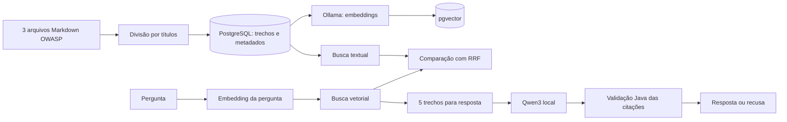

# Guia geral de estudo — SecDocs RAG em Java

Este guia acompanha o projeto local `secdocs-rag`. Leia o [README](README.md) para instalar e o [código](src/main/java/dev/secdocs) para acompanhar cada etapa. O objetivo é entender tanto as decisões que funcionaram quanto os resultados que contrariaram a expectativa inicial.

## 1. O problema e a solução

Um modelo de linguagem sozinho pode responder com base em conhecimento antigo ou inventar fontes. O SecDocs RAG limita o contexto a três Cheat Sheets públicos da OWASP. Para cada pergunta, ele busca trechos relevantes, pede ao modelo local uma resposta curta e só entrega citações cuja frase exista literalmente no trecho armazenado. Se a evidência for insuficiente, responde que não encontrou base.

**RAG** significa *Retrieval-Augmented Generation*: recuperação antes da geração. A recuperação decide quais textos entram no contexto; a geração transforma esses textos em uma resposta. São problemas distintos e precisam de avaliações distintas.

## 2. Mapa do fluxo



O projeto usa **Java para toda a lógica**. A tela de demonstração é um formulário HTML/CSS renderizado no servidor pelo Spring com Thymeleaf, sem JavaScript. PostgreSQL e Ollama rodam localmente em Docker.

## 3. Etapas, com as classes para ler

### Etapa A — Ingestão

- [`SourceCatalog`](src/main/java/dev/secdocs/ingest/SourceCatalog.java) define as três fontes e a revisão fixa do repositório OWASP.
- [`OwaspIngestion`](src/main/java/dev/secdocs/ingest/OwaspIngestion.java) baixa o Markdown.
- [`MarkdownChunker`](src/main/java/dev/secdocs/ingest/MarkdownChunker.java) divide pelo caminho de títulos e limita o tamanho aproximado.
- [`StoreChunks`](src/main/java/dev/secdocs/ingest/StoreChunks.java) faz *upsert* no PostgreSQL. Reexecutar não deve criar duplicatas.

**Conceito Java:** `record` representa dados imutáveis como `DocumentChunk`; `ApplicationRunner` executa uma tarefa no início da aplicação quando uma opção específica está ativa; `try-with-resources` fecha conexões e consultas JDBC.

### Etapa B — Vetores

- [`OllamaEmbeddingClient`](src/main/java/dev/secdocs/embed/OllamaEmbeddingClient.java) chama a API local de embeddings.
- [`EmbedChunks`](src/main/java/dev/secdocs/embed/EmbedChunks.java) processa apenas trechos sem vetor ou com digest antigo.
- [`V2__add_embedding_index.sql`](src/main/resources/db/migration/V2__add_embedding_index.sql) cria a coluna de 1.024 dimensões e o índice HNSW.

Um embedding é uma lista de números que permite comparar a proximidade semântica de textos. O modelo `bge-m3:567m` foi escolhido para perguntas em português e documentos em inglês. O digest registrado junto do vetor evita misturar resultados de versões de modelo diferentes.

**Conceito Java:** `HttpClient` faz chamadas HTTP ao Ollama; JSON entra e sai por `ObjectMapper`; exceções de rede e de formato precisam ser tratadas separadamente do resultado da busca.

### Etapa C — Busca

- [`SearchEngine`](src/main/java/dev/secdocs/search/SearchEngine.java) contém as três modalidades.
- Busca vetorial ordena por distância de cosseno no pgvector.
- Busca textual usa `tsvector`/`websearch_to_tsquery` em inglês no PostgreSQL.
- Busca híbrida usa **RRF**: cada resultado recebe `1/(60 + posição)`, somando as contribuições quando aparece nas duas listas. A pontuação de RRF não é uma probabilidade.

**Conceito Java:** `PreparedStatement` passa a pergunta como parâmetro SQL; `EnumMap` organiza os modos de busca; `Stream` ajuda a transformar e limitar resultados. A pergunta nunca deve ser concatenada na instrução SQL.

### Etapa D — Geração e recusa

- [`AnswerService`](src/main/java/dev/secdocs/answer/AnswerService.java) coordena busca, limiar e validação.
- [`OllamaAnswerModel`](src/main/java/dev/secdocs/answer/OllamaAnswerModel.java) envia pergunta e evidência ao `qwen3:1.7b` e exige JSON estruturado.
- [`AnswerController`](src/main/java/dev/secdocs/answer/AnswerController.java) expõe `POST /api/ask`.

O limiar de similaridade `0,55` foi escolhido observando este conjunto pequeno de perguntas. Se o melhor resultado não atingir esse valor, o modelo não é consultado. Se o modelo devolver uma citação cujo ID não foi recuperado ou cuja frase não aparece no texto original, essa citação é descartada. Sem citações válidas, a resposta vira recusa. Isso **não verifica semanticamente todas as afirmações** da resposta; é uma barreira parcial contra fontes inventadas.

**Conceito Java:** interfaces permitem trocar `AnswerModel` em testes; injeção de dependência pelo construtor liga as classes; `record` torna explícito o contrato de resposta. `@Valid`, `@NotBlank` e `@Size` validam a entrada HTTP.

### Etapa E — Avaliação e segurança

- [`golden-set.json`](evals/golden-set.json) guarda 25 perguntas com fonte esperada e 5 fora do acervo.
- [`EvaluateRetrieval`](src/main/java/dev/secdocs/eval/EvaluateRetrieval.java) mede se um trecho esperado aparece no top 5.
- [`ProbePromptInjection`](src/main/java/dev/secdocs/eval/ProbePromptInjection.java) testa uma instrução maliciosa em evidência sintética.
- [`ApiRateLimitFilter`](src/main/java/dev/secdocs/ApiRateLimitFilter.java) limita chamadas locais por IP.

O CI contém testes Java e um job que recria banco, corpus, embeddings e a avaliação. A primeira execução no GitHub passou nos dois jobs; veja o [registro da execução](https://github.com/munhoz-iago/secdocs-rag/actions/runs/37870314187).

## 4. O que os números mostram

| Modalidade | Trecho esperado no top 5 | Leitura correta |
|---|---:|---|
| Vetorial | 25/25, 100% | Melhor neste conjunto pequeno |
| Textual | 5/25, 20% | Configuração inglesa prejudicou muitas perguntas em português |
| Híbrida | 24/25, 96% | A fusão perdeu um acerto da busca vetorial |

O resultado híbrido é um aprendizado importante: combinar técnicas não garante melhora. A geração usa o resultado vetorial porque foi o melhor medido aqui. A pergunta `auth-08`, sobre perguntas de segurança, mostra a perda causada pela fusão. O próximo experimento deve usar perguntas independentes, sem ajustar o algoritmo durante a montagem do conjunto.

**Cuidado com métricas:** `recall@5` mede recuperação, não se a resposta gerada está correta. Os cinco casos sem resposta não contam no denominador de recall. O limiar de recusa foi ajustado olhando esse mesmo conjunto, portanto não há validação independente da recusa.

## 5. Como executar para aprender

Siga os comandos completos do [README](README.md). Depois de iniciar a API, experimente no PowerShell:

```powershell
$body = @{question='Como consultas parametrizadas ajudam a prevenir SQL injection?'} | ConvertTo-Json
Invoke-RestMethod http://localhost:8080/api/ask -Method Post -ContentType 'application/json' -Body $body
```

Abra `http://localhost:8080` para usar a tela. Faça também uma pergunta fora do corpus, como previsão do tempo. Compare `VECTOR`, `KEYWORD` e `HYBRID` em `POST /api/search` e observe os IDs e scores.

Para estudar o código em ordem: comece por `DocumentChunk`, `MarkdownChunker`, `StoreChunks`, `OllamaEmbeddingClient`, `SearchEngine`, `AnswerService` e termine em `EvaluateRetrieval`. Em cada classe, pergunte: **qual dado entra, qual dado sai, qual falha pode ocorrer e como ela é detectada?**

## 6. Exercícios curtos

1. Adicione cinco perguntas novas sobre seções ainda não usadas. Defina o ID esperado **antes** de rodar a busca; só depois calcule recall@5.
2. Compare o top 5 de uma pergunta em português com sua tradução em inglês. Explique a diferença do índice textual.
3. Mude `RRF_K` apenas em uma cópia experimental. Meça quais perguntas ganham e perdem; não aceite só a média.
4. Escreva um teste para uma citação cujo ID existe, mas cuja frase foi modificada por uma palavra. A resposta deve recusar se não restar outra citação válida.
5. Crie uma pergunta de segurança próxima do corpus, mas sem resposta nele. Verifique se o limiar `0,55` a recusa e registre quando falhar.
6. Faça uma revisão manual de cinco respostas: sublinhe cada afirmação e indique exatamente a frase da fonte que a sustenta. Registre qualquer afirmação sem suporte.

## 7. Como apresentar a recrutadores

> “Construí em Java um RAG local sobre três Cheat Sheets da OWASP. Uso PostgreSQL com pgvector para busca vetorial, comparo com busca textual e RRF, e avalio recuperação com 30 perguntas. No conjunto inicial, a busca vetorial encontrou 25/25 fontes esperadas no top 5; a híbrida encontrou 24/25. Por isso, mantive as duas para comparação e usei a vetorial na geração. O modelo local responde com citações que o servidor valida literalmente. Sei que o conjunto é pequeno e que citação literal não prova cada afirmação, então documentei esses limites e o próximo experimento.”

Mostre o código, o [resultado por pergunta](evals/results.json) e a [execução do CI](https://github.com/munhoz-iago/secdocs-rag/actions/runs/37870314187). Diga com clareza que uma demo local e um CI verde não tornam a API pronta para produção. Essa honestidade facilita uma conversa técnica real.

## 8. Próximos passos úteis

Construir um conjunto independente com perguntas reais de outras pessoas; medir recusa em temas próximos; avaliar respostas com revisão humana; experimentar índice textual multilíngue e tamanhos de trecho; adicionar Top 10 e ASVS com licenças verificadas; medir tempo e custo de CPU.

