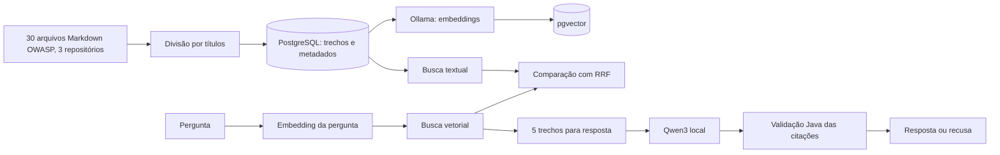

# Guia geral de estudo — SecDocs RAG em Java

Este guia acompanha o projeto local `secdocs-rag`. Leia o [README](README.md) para instalar e o [código](src/main/java/dev/secdocs) para acompanhar cada etapa. O objetivo é entender tanto as decisões que funcionaram quanto os resultados que contrariaram a expectativa inicial.

## 1. O problema e a solução

Um modelo de linguagem sozinho pode responder com base em conhecimento antigo ou inventar fontes. O SecDocs RAG limita o contexto a 30 arquivos Markdown públicos da OWASP: três Cheat Sheets, as dez categorias do Top 10:2025 e 17 capítulos do ASVS 5.0, divididos em 300 trechos. Para cada pergunta, ele busca trechos relevantes, pede ao modelo local uma resposta curta e só entrega citações cuja frase exista literalmente no trecho armazenado. Se a evidência for insuficiente, responde que não encontrou base.

**RAG** significa *Retrieval-Augmented Generation*: recuperação antes da geração. A recuperação decide quais textos entram no contexto; a geração transforma esses textos em uma resposta. São problemas distintos e precisam de avaliações distintas.

## 2. Mapa do fluxo



O projeto usa **Java para toda a lógica**. A tela de demonstração é um formulário HTML/CSS renderizado no servidor pelo Spring com Thymeleaf, sem JavaScript. PostgreSQL e Ollama rodam localmente em Docker.

## 3. Etapas, com as classes para ler

### Etapa A — Ingestão

- [`SourceCatalog`](src/main/java/dev/secdocs/ingest/SourceCatalog.java) lê [`owasp-sources.properties`](src/main/resources/owasp-sources.properties), com 30 fontes de três repositórios OWASP; cada arquivo traz repositório, caminho, revisão fixa e licença.
- [`OwaspIngestion`](src/main/java/dev/secdocs/ingest/OwaspIngestion.java) baixa o Markdown.
- [`MarkdownChunker`](src/main/java/dev/secdocs/ingest/MarkdownChunker.java) divide pelo caminho de títulos, remove imagens decorativas dos títulos e limita o tamanho aproximado.
- [`StoreChunks`](src/main/java/dev/secdocs/ingest/StoreChunks.java) faz *upsert* no PostgreSQL. Reexecutar não deve criar duplicatas.

**Conceito Java:** `record` representa dados imutáveis como `DocumentChunk`; `ApplicationRunner` executa uma tarefa no início da aplicação quando uma opção específica está ativa; `try-with-resources` fecha conexões e consultas JDBC.

### Etapa B — Vetores

- [`OllamaEmbeddingClient`](src/main/java/dev/secdocs/embed/OllamaEmbeddingClient.java) chama a API local de embeddings.
- [`EmbedChunks`](src/main/java/dev/secdocs/embed/EmbedChunks.java) processa apenas trechos sem vetor ou com digest antigo.
- [`V2__add_embedding_index.sql`](src/main/resources/db/migration/V2__add_embedding_index.sql) cria a coluna de 1.024 dimensões e o índice HNSW.

Um embedding é uma lista de números que permite comparar a proximidade semântica de textos. O modelo `bge-m3:567m` foi escolhido para perguntas em português e documentos em inglês. O digest registrado junto do vetor evita misturar resultados de versões de modelo diferentes.

**Conceito Java:** `HttpClient` faz chamadas HTTP ao Ollama; JSON entra e sai por `ObjectMapper`; exceções de rede e de formato precisam ser tratadas separadamente do resultado da busca.

### Etapa C — Busca

- [`SearchEngine`](src/main/java/dev/secdocs/search/SearchEngine.java) contém as três modalidades.
- Busca vetorial ordena por distância de cosseno no pgvector.
- Busca textual usa `tsvector`/`websearch_to_tsquery` com stemming inglês no PostgreSQL. Os termos da pergunta são extraídos como palavras em Java e combinados por OR, para que aspas e sinais de menos não sejam interpretados como operadores.
- Busca híbrida usa **RRF**: cada resultado recebe `1/(60 + posição)`, somando as contribuições quando aparece nas duas listas; cada modo fornece até 20 candidatos. A pontuação de RRF não é uma probabilidade.

**Conceito Java:** `PreparedStatement` passa a pergunta como parâmetro SQL; `EnumMap` organiza os modos de busca; `Stream` ajuda a transformar e limitar resultados. A pergunta nunca deve ser concatenada na instrução SQL.

### Etapa D — Geração e recusa

- [`AnswerService`](src/main/java/dev/secdocs/answer/AnswerService.java) coordena busca, limiar e validação.
- [`OllamaAnswerModel`](src/main/java/dev/secdocs/answer/OllamaAnswerModel.java) envia pergunta e evidência ao `qwen3:1.7b` e exige JSON estruturado.
- [`AnswerController`](src/main/java/dev/secdocs/answer/AnswerController.java) expõe `POST /api/ask`.

O limiar de similaridade `0,55` foi escolhido observando o conjunto anterior, de 30 perguntas sobre três Cheat Sheets. No golden set atual, ainda separa respondíveis e sem resposta, com margem estreita; isso não substitui uma avaliação independente. Se o melhor resultado não atingir esse valor, o modelo não é consultado. Toda citação devolvida pelo modelo precisa ter um ID recuperado e uma frase contígua presente no texto original; se qualquer citação falhar, a resposta inteira vira recusa. Código entre crases ou em bloco só passa se aparecer literalmente dentro de uma citação validada, e texto com sinais de código fora disso (crases soltas, ponto e vírgula em posição de código, tags, operadores de shell, pares de palavras-chave SQL) também leva à recusa. Essa checagem é heurística e não detecta toda sintaxe. Isso **não verifica semanticamente todas as afirmações** da resposta; é uma barreira parcial contra fontes inventadas.

**Conceito Java:** interfaces permitem trocar `AnswerModel` em testes; injeção de dependência pelo construtor liga as classes; `record` torna explícito o contrato de resposta. `@Valid`, `@NotBlank` e `@Size` validam a entrada HTTP.

### Etapa E — Avaliação e segurança

- [`golden-set.json`](evals/golden-set.json) guarda 45 perguntas: 40 com fonte esperada e 5 fora do acervo. Quinze perguntas respondíveis em português têm também uma versão em inglês (`englishQuestion`).
- [`EvaluateRetrieval`](src/main/java/dev/secdocs/eval/EvaluateRetrieval.java) mede se um trecho esperado aparece no top 5 e avalia separadamente as versões em inglês, mostrando o resultado por idioma apenas para os itens traduzidos.
- [`ProbePromptInjection`](src/main/java/dev/secdocs/eval/ProbePromptInjection.java) testa uma instrução maliciosa em evidência sintética.
- [`ApiRateLimitFilter`](src/main/java/dev/secdocs/ApiRateLimitFilter.java) limita chamadas locais por IP.

O CI contém testes Java e um job que recria banco, corpus, embeddings e a avaliação. A primeira execução no GitHub passou nos dois jobs, mas cobriu a versão anterior, com três documentos e 30 perguntas; veja o [registro da execução](https://github.com/munhoz-iago/secdocs-rag/actions/runs/37870314187). O acervo atual ainda não foi executado no CI.

## 4. O que os números mostram

Execução local no acervo atual (30 fontes, 300 trechos, 45 perguntas, 40 respondíveis):

| Modalidade | Trecho esperado no top 5 | 15 itens traduzidos: português / inglês | Leitura correta |
|---|---:|---:|---|
| Vetorial | 39/40, 97,5% | 14/15 / 15/15 | Melhor neste conjunto; errou só `auth-01` |
| Textual | 27/40, 67,5% | 9/15 / 12/15 | Melhorou com OR, mas ainda sofre com português e autenticação |
| Híbrida | 38/40, 95,0% | 14/15 / 14/15 | A fusão perdeu `auth-06`, que a vetorial acertou |

Na execução anterior (3 documentos, 103 trechos, 30 perguntas), os números eram 25/25, 5/25 e 24/25. Acervo, perguntas e busca textual mudaram, então as porcentagens não são diretamente comparáveis.

O resultado híbrido continua sendo um aprendizado importante: combinar técnicas não garante melhora. Na execução anterior, a fusão perdeu `auth-08` (perguntas de segurança); nesta, `auth-08` foi acertada, e a perda passou a ser `auth-06` (MFA contra ataques automatizados), cujo trecho esperado estava no top 5 vetorial e saiu do top 5 após a fusão. A geração continua usando o resultado vetorial, que foi o melhor medido nas duas execuções. O único erro vetorial, `auth-01` (força de senha, em português), mostra outro efeito do acervo maior: trechos do Top 10 e do ASVS sobre senhas ocuparam o lugar do Cheat Sheet esperado. O próximo experimento deve usar perguntas independentes, conforme o [protocolo para avaliação independente](BLIND_EVAL_PROTOCOL.md), sem ajustar o algoritmo durante a montagem do conjunto.

**Cuidado com métricas:** `recall@5` mede recuperação, não se a resposta gerada está correta. Os cinco casos sem resposta não contam no denominador de recall. O limiar de recusa foi ajustado olhando o conjunto anterior de 30 perguntas. No conjunto atual, ele ainda separa as respondíveis (score vetorial máximo a partir de `0,562`) das sem resposta (até `0,527`), mas com margem estreita; não há validação independente da recusa.

## 5. Como executar para aprender

Siga os comandos completos do [README](README.md). Depois de iniciar a API, experimente no PowerShell:

```powershell
$body = @{question='Como consultas parametrizadas ajudam a prevenir SQL injection?'} | ConvertTo-Json
Invoke-RestMethod http://localhost:8080/api/ask -Method Post -ContentType 'application/json' -Body $body
```

Abra `http://localhost:8080` para usar a tela. Faça também uma pergunta fora do corpus, como previsão do tempo. Compare `VECTOR`, `KEYWORD` e `HYBRID` em `POST /api/search` e observe os IDs e scores.

Para estudar o código em ordem: comece por `DocumentChunk`, `MarkdownChunker`, `StoreChunks`, `OllamaEmbeddingClient`, `SearchEngine`, `AnswerService` e termine em `EvaluateRetrieval`. Em cada classe, pergunte: **qual dado entra, qual dado sai, qual falha pode ocorrer e como ela é detectada?**

## 6. Exercícios curtos

1. Adicione cinco perguntas novas sobre seções ainda não usadas. Defina o ID esperado **antes** de rodar a busca; só depois calcule recall@5.
2. Em `evals/results.json`, compare o top 5 de uma pergunta em português com o da sua versão em inglês (`englishQuestion`), registrado separadamente pela avaliação. Explique a diferença do índice textual.
3. Mude `RRF_K` apenas em uma cópia experimental. Meça quais perguntas ganham e perdem; não aceite só a média.
4. Escreva um teste para uma citação cujo ID existe, mas cuja frase foi modificada por uma palavra. A resposta deve recusar, mesmo que outra citação seja válida.
5. Crie uma pergunta de segurança próxima do corpus, mas sem resposta nele. Verifique se o limiar `0,55` a recusa e registre quando falhar.
6. Faça uma revisão manual de cinco respostas: sublinhe cada afirmação e indique exatamente a frase da fonte que a sustenta. Registre qualquer afirmação sem suporte.

## 7. Como apresentar a recrutadores

> “Construí em Java um RAG local sobre 30 arquivos da OWASP (Cheat Sheets, Top 10:2025 e ASVS 5.0), divididos em 300 trechos. Uso PostgreSQL com pgvector para busca vetorial, comparo com busca textual e RRF, e avalio recuperação com 45 perguntas. Numa execução local, a busca vetorial encontrou a fonte esperada no top 5 em 39 das 40 perguntas respondíveis e a híbrida, em 38; por isso a geração usa a vetorial. O modelo local responde com citações que o servidor valida literalmente, e prefere recusar a aceitar uma citação que não confere. Sei que essas perguntas foram escritas por mim, que o conjunto é pequeno e que citação literal não prova cada afirmação; documentei esses limites, as recusas indevidas que observei e o próximo experimento, com perguntas independentes.”

Mostre o código, o [resultado por pergunta](evals/results.json) e a [execução do CI](https://github.com/munhoz-iago/secdocs-rag/actions/runs/37870314187), que cobriu a versão anterior, com três documentos; o acervo atual ainda não foi executado no CI. Diga com clareza que uma demo local e um CI verde não tornam a API pronta para produção. Essa honestidade facilita uma conversa técnica real.

## 8. Próximos passos úteis

Executar a avaliação do acervo de 300 trechos no CI; reduzir recusas indevidas da geração; construir um conjunto independente com perguntas reais de outras pessoas, seguindo o [protocolo para avaliação independente](BLIND_EVAL_PROTOCOL.md); medir recusa em temas próximos; avaliar respostas com revisão humana; experimentar índice textual multilíngue e tamanhos de trecho; medir tempo e custo de CPU.

