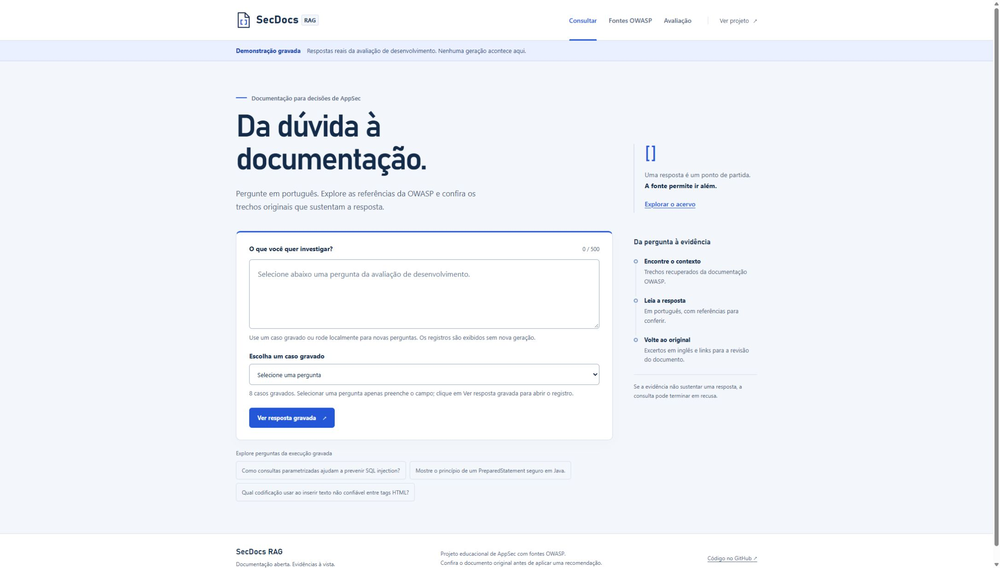
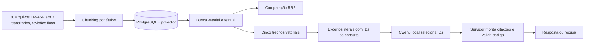

# SecDocs RAG

[](https://github.com/munhoz-iago/secdocs-rag/actions/workflows/ci.yml)

Um espaço de consulta a documentação de segurança: faça uma pergunta, examine as evidências originais e compare os resultados de busca. Construído em **Java 21, Spring Boot, PostgreSQL com pgvector e Ollama local**, com 30 arquivos OWASP em revisões fixas: três Cheat Sheets, dez categorias do Top 10:2025 e 17 capítulos do ASVS 5.0.

**[Explorar demonstração pública](https://munhoz-iago.github.io/secdocs-rag/)** · [Arquitetura](ARCHITECTURE.md) · [Avaliação de respostas](docs/GENERATION_EVALUATION.md) · [Limitações](LIMITATIONS.md)

A demonstração pública reproduz respostas reais gravadas em um conjunto de desenvolvimento. Novas perguntas são processadas na aplicação local; o banco e os modelos não são expostos na internet.



## O que explorar

- **Consultar:** resposta com citações copiadas pelo servidor, motivo de recusa, duração, tentativas e trechos recuperados. A opção de buscar apenas evidências dispensa a geração.
- **Fontes OWASP:** catálogo pesquisável por título e família, com versão fixada, atribuição e link para o arquivo original.
- **Avaliação:** comparação visual das três buscas, resultados por pergunta e execução de geração. Os números exibidos vêm de snapshots publicados, identificados como desenvolvimento.

A interface usa Thymeleaf e JavaScript progressivo, com carregamento, cancelamento de espera, estados de erro e adaptação a telas pequenas. A consulta por formulário continua disponível sem JavaScript na aplicação local.

## Demonstração local

Requisitos: Java 21+, Docker Desktop e internet na instalação inicial. O Maven Wrapper acompanha o projeto. No PowerShell, a partir da raiz do repositório:

```powershell
Copy-Item .env.example .env
# Substitua a senha de exemplo em .env por uma senha local; nunca a publique.
docker compose up -d --wait
docker compose exec -T ollama ollama pull bge-m3:567m
docker compose exec -T ollama ollama pull qwen3:1.7b
.\mvnw.cmd package
```

Prepare o banco e execute a API:

```powershell
$env:SECDOCS_DB_URL = 'jdbc:postgresql://localhost:5433/secdocs'
$env:SECDOCS_DB_USER = 'secdocs'
$env:SECDOCS_DB_PASSWORD = ((Get-Content .env -Raw) -split '=', 2)[1].Trim()
$jar = 'target\secdocs-rag-0.0.1-SNAPSHOT.jar'
java -jar $jar --secdocs.ingest=true --spring.main.web-application-type=none
java -jar $jar --secdocs.store=true --spring.main.web-application-type=none
java -jar $jar --secdocs.embed=true --spring.main.web-application-type=none
java -jar $jar
```

Abra [http://localhost:8080](http://localhost:8080). Os comandos de preparo podem ser repetidos: a gravação atualiza IDs existentes e a geração de vetores processa apenas trechos pendentes. A primeira geração local pode demorar em CPU. A API escuta somente em `127.0.0.1` e não possui autenticação.

## API

`POST /api/ask` recebe `{"question":"Como consultas parametrizadas previnem SQL injection?"}` e devolve `answer`, `abstained`, citações literais, `outcome`, `attempts`, `durationMs`, `evidence` e `citationStrategy`. `POST /api/search` recebe `question`, `mode` (`VECTOR`, `KEYWORD` ou `HYBRID`) e `limit` (1–10). `GET /api/workspace` entrega catálogo e snapshots publicados sem depender de banco ou modelo; `GET /api/status` verifica a aplicação. As perguntas têm até 500 caracteres; as rotas POST da API e do formulário têm limite local de 20 pedidos por minuto por endereço IP.

```powershell
$body = @{question='Como consultas parametrizadas previnem SQL injection?'} | ConvertTo-Json
Invoke-RestMethod http://localhost:8080/api/ask -Method Post -ContentType 'application/json' -Body $body
```

## Melhorias desta versão

- **Ingestão:** antes de gravar, o programa exige as 30 fontes do catálogo, confere revisão e URL, e rejeita IDs duplicados. A reimportação remove trechos antigos e fontes retiradas do catálogo; conteúdo alterado invalida o embedding correspondente.
- **Busca e avaliação:** a busca textual combina palavras por OR sem deixar aspas ou `-termo` virarem operadores. O golden set passou a incluir Top 10 e ASVS; as 15 traduções são avaliadas como pares PT/EN, e a avaliação falha se um ID esperado não existir no banco.
- **Respostas e citações:** o modelo seleciona IDs de excertos fornecidos e o servidor monta as citações a partir do texto original. IDs desconhecidos ou repetidos são rejeitados. Código só é aceito quando aparece integralmente na citação selecionada; uma falha de validação pode receber uma única correção. Isso verifica origem e literalidade, sem garantir correspondência semântica entre resposta e fonte. [Decisão e limites](docs/decisions/0003-server-owned-citations.md).
- **Experiência e transparência:** navegação entre consulta, fontes e avaliação, filtros, visualizações baseadas em relatórios reais e demonstração pública gravada. Conteúdo externo é exibido como texto; links se restringem aos arquivos OWASP fixados.

**Limite ainda aberto:** `qwen3:1.7b` continua recusando perguntas legítimas e pode fazer afirmações que não decorrem das citações. Na comparação atual, 4/6 perguntas legítimas receberam resposta com citações, contra 3/6 antes. Isso **não significa 4 respostas corretas**: a revisão assistida identificou uma mistura de categorias no Top 10 e ressalvas de escopo no ASVS. Veja os [resultados e a revisão](EVALS.md). O conjunto independente ainda não foi coletado.

### Geração: comparação controlada de desenvolvimento

Mesmo conjunto congelado de oito perguntas, mesmo digest de `qwen3:1.7b`, mesmo corpus e ordem. Uma execução por versão em CPU:

| Medida | Citação copiada pelo modelo | Citação montada pelo servidor |
|---|---:|---:|
| Perguntas legítimas respondidas com citações | 3/6 | 4/6 |
| Recusas em perguntas legítimas | 3/6 | 2/6 |
| Perguntas fora do acervo recusadas | 2/2 | 2/2 |

A mudança melhora a disponibilidade nesse conjunto, sem demonstrar melhora geral de fidelidade. Prompt e orçamento de saída também mudaram. [Comparação verificável](evals/generation-comparison.json), [respostas completas](evals/generation-results.json) e [revisão assistida por Claude, não independente](evals/generation-review.json). Há **149 testes Java** passando localmente e no CI; a avaliação de geração é opt-in e não roda por padrão no CI.

## Resultados medidos

Golden set atual: 45 perguntas, sendo 40 com fonte esperada e 5 fora do acervo. `Recall@5` significa a proporção das 40 perguntas respondíveis em que ao menos um trecho esperado apareceu entre os cinco primeiros. Quinze perguntas respondíveis em português têm também uma versão em inglês (`englishQuestion`), avaliada separadamente; o relatório mostra o resultado por idioma apenas para esses itens traduzidos.

**Execuções local e no CI no acervo atual** (30 fontes, 300 trechos, 45 perguntas, 40 respondíveis):

| Busca | Acertos | Recall@5 | Itens traduzidos: português | Itens traduzidos: inglês |
|---|---:|---:|---:|---:|
| Vetorial, `bge-m3:567m` | 39/40 | 97,5% | 14/15 | 15/15 |
| Textual, configuração inglesa | 27/40 | 67,5% | 9/15 | 12/15 |
| Híbrida, RRF k=60 | 38/40 | 95,0% | 14/15 | 14/15 |

A busca vetorial errou só `auth-01` (força de senha, em português), em que trechos do Top 10 e do ASVS sobre senhas ocuparam o top 5. A híbrida errou também `auth-06`, que a vetorial acertou. Na execução anterior (3 documentos, 30 perguntas), os resultados foram 25/25, 5/25 e 24/25; como acervo, perguntas e busca textual mudaram, os números não são diretamente comparáveis.

Esses números vêm de um conjunto pequeno, criado com conhecimento das seções. O limiar de recusa `0,55` foi escolhido no conjunto anterior; neste conjunto, ainda separa as respondíveis (score vetorial máximo de `0,562` a `0,796`) das sem resposta (`0,337` a `0,527`), mas com margem estreita. **Não medem qualidade em produção nem provam superioridade geral da busca vetorial.** A geração continua usando os cinco resultados vetoriais, que também foram os melhores nesta execução; a API mantém os três modos para experimentos. Veja [EVALS.md](EVALS.md), os resultados por pergunta em [evals/results.json](evals/results.json) e o [protocolo para avaliação independente](BLIND_EVAL_PROTOCOL.md), que descreve como medir o sistema com perguntas escritas por outras pessoas.

Para repetir a avaliação após a preparação do banco:

```powershell
java -jar $jar --secdocs.eval=true --secdocs.min-recall=0.8 --spring.main.web-application-type=none
```

O pipeline do GitHub Actions roda testes Java e recria o banco, vetores e avaliação; o limite de regressão é 80% para a busca vetorial. A [execução da versão atual, concluída em 13/10/2026](https://github.com/munhoz-iago/secdocs-rag/actions/runs/38338795262) passou com 149 testes Java e, no job de avaliação com banco e Ollama limpos, 300 trechos, 39/40 na busca vetorial, 27/40 na textual e 38/40 na híbrida, iguais ao snapshot local publicado. A comparação de geração também foi conferida contra os hashes e os registros congelados. O CI mede recuperação, não a taxa de respostas legítimas recusadas pelo gerador. A prova de injeção de prompt registrada em [evals/prompt-injection-result.json](evals/prompt-injection-result.json) passou em um cenário sintético isolado. A [publicação da demonstração](https://github.com/munhoz-iago/secdocs-rag/actions/runs/38338795263) também concluiu com sucesso.

## Como funciona



O código principal fica em `src/main/java/dev/secdocs`: `ingest` baixa e divide; `embed` gera vetores; `search` recupera; `answer` consulta o modelo e valida as citações; `eval` mede recuperação e geração e executa uma prova de injeção de prompt; `workspace` expõe catálogo e relatórios à interface. [ARCHITECTURE.md](ARCHITECTURE.md) detalha o fluxo e [LIMITATIONS.md](LIMITATIONS.md) descreve os riscos.

## Fontes e licença

O acervo reúne 30 arquivos Markdown de três repositórios da OWASP, cada um fixado em uma revisão:

| Projeto | Arquivos | Revisão |
|---|---:|---|
| [OWASP Cheat Sheet Series](https://github.com/OWASP/CheatSheetSeries): SQL Injection Prevention, Cross Site Scripting Prevention e Authentication | 3 | `29994dd8a2e6f50fa3d5607b046b54d7c6945afd` |
| [OWASP Top 10](https://github.com/OWASP/Top10): categorias A01 a A10 do Top 10:2025 | 10 | `3a31f35346c3f4e90f350395124382fa53af2afe` |
| [OWASP ASVS](https://github.com/OWASP/ASVS): capítulos V1 a V17 do ASVS 5.0 | 17 | `61a544f0fdbb7cc1578e0c3a3037a8a2874a944e` |

A lista completa, com repositório, caminho, revisão e licença de cada arquivo, está em [`src/main/resources/owasp-sources.properties`](src/main/resources/owasp-sources.properties). Os textos são distribuídos pela OWASP sob [CC BY-SA 4.0](https://creativecommons.org/licenses/by-sa/4.0/), conforme registrado no catálogo; confira o arquivo de licença de cada repositório na revisão indicada antes de redistribuir. Os trechos preservam URL no GitHub, revisão e licença. O código deste repositório está sob [MIT](LICENSE).

## Decisões e estudo

- [Embeddings locais multilíngues](docs/decisions/0001-local-multilingual-embeddings.md)
- [Recuperação e geração](docs/decisions/0002-retrieval-and-generation.md)
- [Citações montadas pelo servidor](docs/decisions/0003-server-owned-citations.md)
- [Avaliação reproduzível de geração](docs/GENERATION_EVALUATION.md)
- [Avaliações reproduzíveis](EVALS.md)
- [Protocolo para avaliação independente](BLIND_EVAL_PROTOCOL.md)
- [Guia geral para estudar o projeto](GUIA_GERAL_SECDOCS_RAG.md)
- [Plano de estudos por sessões](PLANO_DE_ESTUDOS.md)

## Reproduzir a demonstração pública

Com a aplicação local aberta e os snapshots já publicados:

```powershell
python scripts/compare_generation.py --check
python scripts/export_demo.py
python -m http.server 8082 --directory site --bind 127.0.0.1
```

Abra `http://localhost:8082`. O exportador usa somente a página renderizada, os arquivos estáticos, o catálogo e os resultados registrados. O workflow `pages.yml` repete essa exportação e publica no GitHub Pages, sem banco, inferência, chaves ou histórico de usuários. Consulte o [estudo de caso](docs/CASE_STUDY.md) para uma leitura guiada do projeto.
