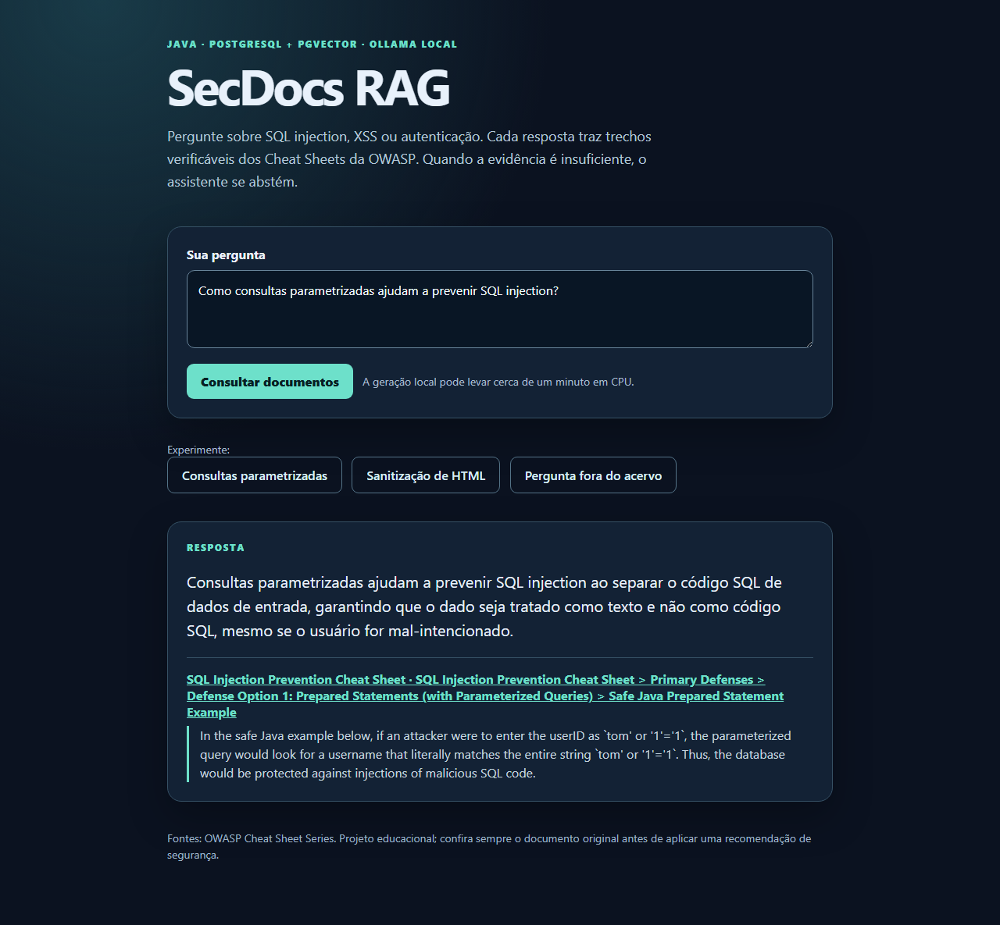
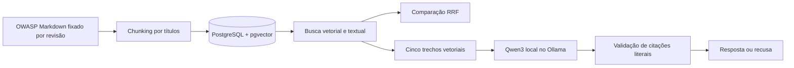

# SecDocs RAG

[](https://github.com/munhoz-iago/secdocs-rag/actions/workflows/ci.yml)

Assistente local em **Java 21** para consultar três documentos públicos da OWASP com citações. Ele ingere Markdown, divide por seção, armazena vetores no PostgreSQL com pgvector, compara busca vetorial, textual e híbrida, e gera respostas com o Ollama. Uma pergunta sem evidência suficiente recebe uma recusa. A página é renderizada pelo Spring com Thymeleaf, sem JavaScript.



## Demonstração local

Requisitos: Java 21+, Docker Desktop e internet na instalação inicial. O Maven Wrapper acompanha o projeto. No PowerShell, a partir da raiz do repositório:

```powershell
Copy-Item .env.example .env
# Substitua a senha de exemplo em .env por uma senha local; nunca a publique.
docker compose up -d --wait
docker compose exec -T ollama ollama pull bge-m3:567m
docker compose exec -T ollama ollama pull qwen3:1.7b
.\mvnw.cmd package
```

Prepare o banco e execute a API:

```powershell
$env:SECDOCS_DB_URL = 'jdbc:postgresql://localhost:5433/secdocs'
$env:SECDOCS_DB_USER = 'secdocs'
$env:SECDOCS_DB_PASSWORD = ((Get-Content .env -Raw) -split '=', 2)[1].Trim()
$jar = 'target\secdocs-rag-0.0.1-SNAPSHOT.jar'
java -jar $jar --secdocs.ingest=true --spring.main.web-application-type=none
java -jar $jar --secdocs.store=true --spring.main.web-application-type=none
java -jar $jar --secdocs.embed=true --spring.main.web-application-type=none
java -jar $jar
```

Abra [http://localhost:8080](http://localhost:8080). Os comandos de preparo podem ser repetidos: a gravação atualiza IDs existentes e a geração de vetores processa apenas trechos pendentes. A primeira geração local pode demorar em CPU. A API escuta somente em `127.0.0.1` e não possui autenticação.

## API

`POST /api/ask` recebe `{"question":"Como consultas parametrizadas previnem SQL injection?"}` e devolve `answer`, `abstained` e citações com trecho literal, seção e URL. `POST /api/search` recebe `question`, `mode` (`VECTOR`, `KEYWORD` ou `HYBRID`) e `limit` (1–10). `GET /api/status` verifica a aplicação. Os dois endpoints POST aceitam perguntas de até 500 caracteres e têm limite local de 20 pedidos por minuto por endereço IP.

```powershell
$body = @{question='Como consultas parametrizadas previnem SQL injection?'} | ConvertTo-Json
Invoke-RestMethod http://localhost:8080/api/ask -Method Post -ContentType 'application/json' -Body $body
```

## Resultados medidos

Golden set local: 30 perguntas, sendo 25 com fonte esperada e 5 fora do acervo. `Recall@5` significa a proporção das 25 perguntas em que ao menos um trecho esperado apareceu entre os cinco primeiros.

| Busca | Acertos | Recall@5 |
|---|---:|---:|
| Vetorial, `bge-m3:567m` | 25/25 | 100% |
| Textual, configuração inglesa | 5/25 | 20% |
| Híbrida, RRF k=60 | 24/25 | 96% |

Esses números são de um conjunto pequeno, criado com conhecimento das seções e usado também para escolher o limiar de recusa. **Não medem qualidade em produção nem provam superioridade geral da busca vetorial.** Como a fusão perdeu um acerto neste conjunto, a geração usa os cinco resultados vetoriais; a API mantém os três modos para experimentos. Veja [EVALS.md](EVALS.md) e os resultados por pergunta em [evals/results.json](evals/results.json).

Para repetir a avaliação após a preparação do banco:

```powershell
java -jar $jar --secdocs.eval=true --secdocs.min-recall=0.8 --spring.main.web-application-type=none
```

O pipeline do GitHub Actions roda testes Java e recria o banco, vetores e avaliação; o limite de regressão é 80% para a busca vetorial. A [primeira execução pública](https://github.com/munhoz-iago/secdocs-rag/actions/runs/37870314187) passou nos dois jobs.

## Como funciona



O código principal fica em `src/main/java/dev/secdocs`: `ingest` baixa e divide; `embed` gera vetores; `search` recupera; `answer` consulta o modelo e valida as citações; `eval` mede recuperação e faz uma prova de injeção de prompt. [ARCHITECTURE.md](ARCHITECTURE.md) detalha o fluxo e [LIMITATIONS.md](LIMITATIONS.md) descreve os riscos.

## Fontes e licença

O corpus inicial contém os Cheat Sheets [SQL Injection Prevention](https://cheatsheetseries.owasp.org/cheatsheets/SQL_Injection_Prevention_Cheat_Sheet.html), [Cross Site Scripting Prevention](https://cheatsheetseries.owasp.org/cheatsheets/Cross_Site_Scripting_Prevention_Cheat_Sheet.html) e [Authentication](https://cheatsheetseries.owasp.org/cheatsheets/Authentication_Cheat_Sheet.html), fixados na revisão `29994dd8a2e6f50fa3d5607b046b54d7c6945afd` do [OWASP Cheat Sheet Series](https://github.com/OWASP/CheatSheetSeries). Os trechos preservam URL, revisão e licença [CC BY-SA 4.0](https://github.com/OWASP/CheatSheetSeries/blob/master/LICENSE.md). O código deste repositório está sob [MIT](LICENSE).

## Decisões e estudo

- [Embeddings locais multilíngues](docs/decisions/0001-local-multilingual-embeddings.md)
- [Recuperação e geração](docs/decisions/0002-retrieval-and-generation.md)
- [Avaliações reproduzíveis](EVALS.md)
- [Guia geral para estudar o projeto](GUIA_GERAL_SECDOCS_RAG.md)
- [Plano de estudos por sessões](PLANO_DE_ESTUDOS.md)
