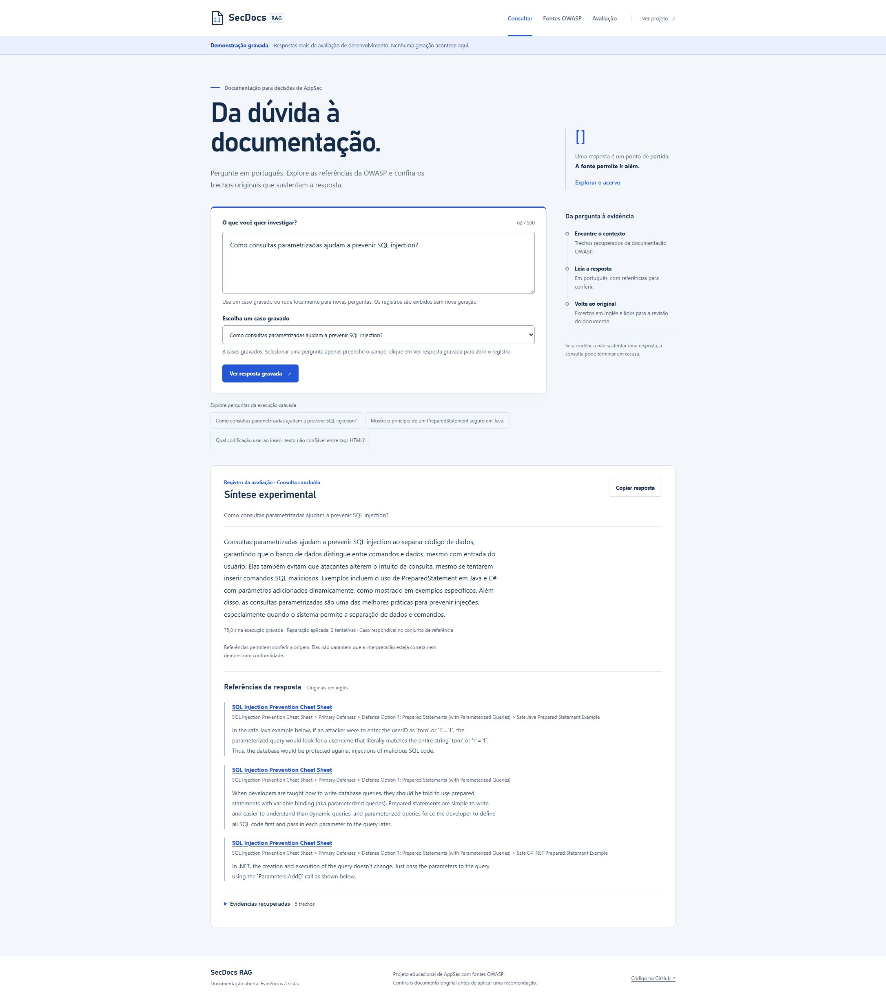
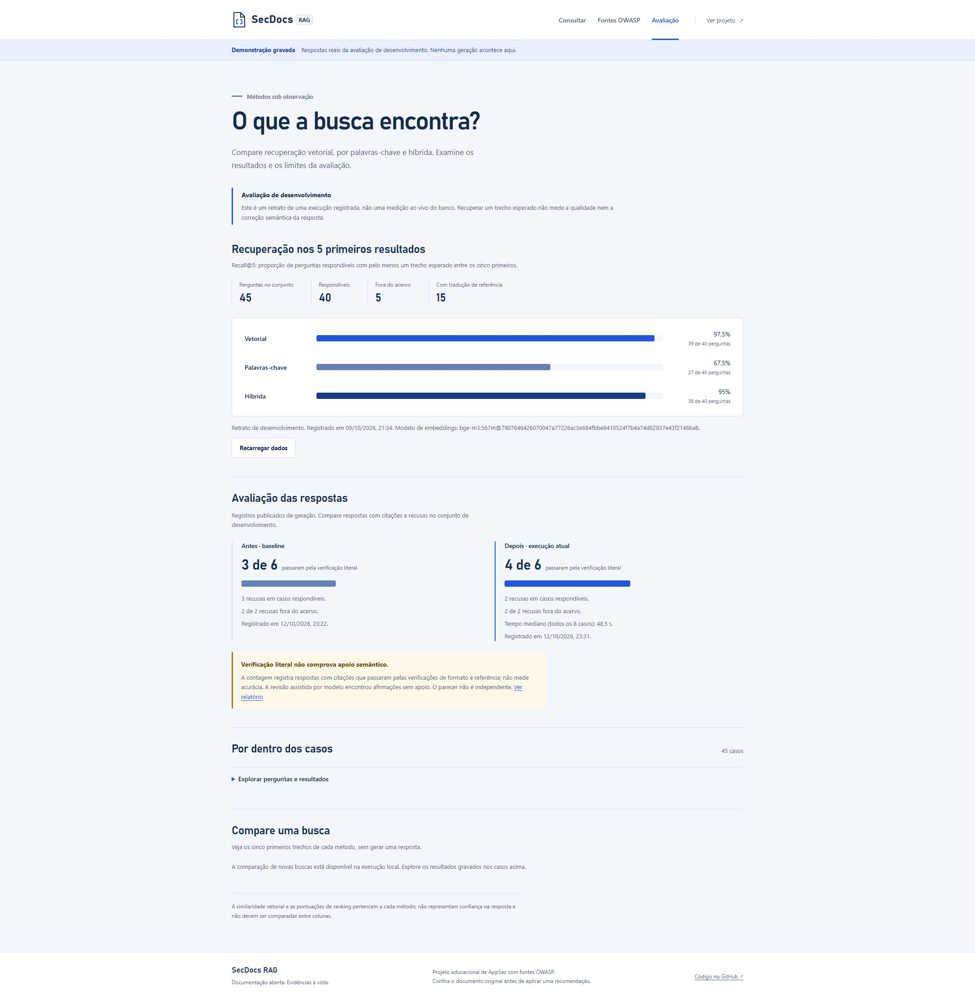

# SecDocs RAG: da recuperação à evidência inspecionável

[Explorar a demonstração](https://munhoz-iago.github.io/secdocs-rag/) · [Código](https://github.com/munhoz-iago/secdocs-rag) · [Arquitetura](../ARCHITECTURE.md)

## O problema

Documentação de segurança está distribuída entre recomendações práticas, categorias de risco e requisitos de verificação. Uma resposta gerada só ajuda quando é possível examinar sua origem e entender seus limites.

SecDocs reúne 30 documentos OWASP em revisões fixas e permite consultar, explorar fontes e comparar métodos de recuperação. O processamento de novas perguntas acontece localmente, em Java e Ollama; a demonstração pública usa registros reais identificados como gravados.

## A decisão que mudou o projeto

A primeira implementação pedia ao modelo que copiasse uma citação. O modelo pequeno frequentemente traduzia ou inventava o excerto, levando a recusas mesmo quando a busca encontrava a fonte.

A versão atual separa a escrita da resposta da construção da citação: Java prepara excertos literais, o modelo escolhe IDs, e o servidor monta as referências. IDs desconhecidos ou repetidos são recusados. O código exibido precisa estar integralmente em uma referência selecionada. O processo admite uma única reparação e registra motivos, tentativas e duração.

Esse desenho reduz uma classe de falhas de cópia. Não resolve a interpretação: escolher um excerto real não prova que uma afirmação decorre dele.

## Resultados que podem ser conferidos

| Verificação | Evidência |
|---|---|
| Recuperação vetorial | 39/40 perguntas respondíveis com trecho esperado no top 5 |
| Textual e híbrida | 27/40 e 38/40, no mesmo conjunto |
| Geração antes/depois | 3/6 e 4/6 perguntas legítimas respondidas com citações |
| Fora do corpus | 2/2 recusadas nas duas versões da geração |
| Testes Java | 149 testes locais passando |
| Inspeção semântica | Erro de categoria no Top 10 e ressalvas de escopo no ASVS, preservados no relatório |

Todos os conjuntos são de desenvolvimento, criados com conhecimento do corpus. A comparação de geração usa o mesmo digest do modelo e o mesmo hash da fixture, com uma execução por versão. Prompt e orçamento de saída também mudaram. Não é uma medição independente nem um benchmark de produção.

A revisão do Claude é assistida por modelo. Ela encontrou problemas que o validador literal não identifica; não deve ser tratada como certificação de qualidade. Os [resultados completos](../evals/generation-results.json), a [comparação verificável](../evals/generation-comparison.json) e a [revisão](../evals/generation-review.json) estão disponíveis.

## Visite em três minutos

1. Em **Consultar**, escolha o caso gravado sobre consultas parametrizadas e confira a resposta e os excertos originais.
2. Em **Fontes OWASP**, filtre ASVS e pesquise por “Session”. Abra a revisão exata no GitHub.
3. Em **Avaliação**, compare as três buscas e as duas versões de geração. Abra os casos para inspecionar os IDs recuperados.
4. Volte ao caso do Top 10 e examine a ressalva da revisão. Esse exemplo mostra por que literalidade e fidelidade semântica precisam de verificações distintas.

## Engenharia demonstrada

- Ingestão idempotente, pré-validação de catálogo e limpeza transacional de trechos obsoletos.
- Embeddings identificados por digest; busca vetorial, textual e fusão RRF comparáveis.
- Fronteira explícita entre documento não confiável, geração, citações e validação de código.
- Interface responsiva, conteúdo externo tratado como texto, filtros e estados de erro/cancelamento.
- Relatórios reproduzíveis, casos de falha publicados e CI de recuperação com banco e modelo preparados do zero.
- Demonstração estática exportada do mesmo produto, sem expor serviços locais.

## Colaboração e próximo passo

O desenvolvimento desta evolução foi dividido entre agentes Codex para interface, catálogo/métricas e harness de avaliação. Claude analisou o plano e revisou as respostas gravadas; uma revisão Codex separada encontrou duas falhas de implementação, corrigidas com testes. O uso de agentes e modelos não substitui a validação humana do produto.

O próximo passo é coletar perguntas externas segundo o [protocolo independente](../BLIND_EVAL_PROTOCOL.md), revisar afirmações e níveis ASVS com uma pessoa da área e comparar modelos sob o mesmo protocolo. Uma possível evolução de produto é relacionar requisitos ASVS a evidências de um projeto, mantendo a decisão de conformidade sob revisão humana.
